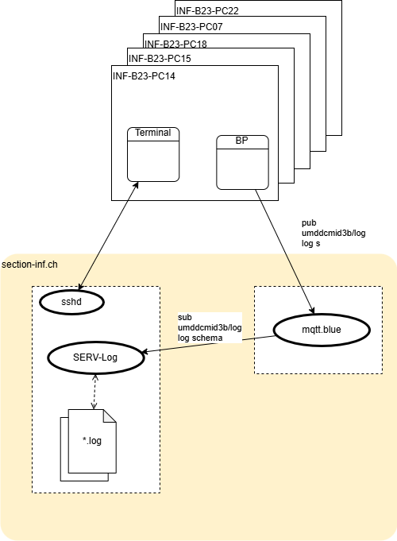

# Carnet de voyage

Du 2 novembre au 23 décembre 2026, la classe CMID3b et moi avons parcouru un chemin d'apprentissage de la programmation de systèmes distribués.
Ce document relate les péripéties de ce voyage, qui part quand même un peu dans l'inconnu...

Les dernières fois que j'ai fait ce cours, nous avions fourni une base de code assez importante que chaque étudiant devait s'approprier pour pouvoir travailler dessus.
Nous avions choisi de faire cela pour minimiser le temps que nous aurions perdu à la recréer durant le cours.

Ce choix a posé pas mal de difficultés à plusieurs élèves, qui avaient de la peine à s'y retrouver.

Pour ce voyage-ci, nous avons décidé de nous en passer car le temps nécessaire à sa réalisation est aujourd'hui drastiquement réduit grâce aux outils d'intelligence artificielle.

Nous ne partons donc pas d'une base éprouvée et connue d'au moins une personne du groupe (moi) et nous allons tout construire ensemble.

## Etape 1

### Lundi 2 novembre

Nous avons survolé rapidement les [objectifs](https://www.modulbaukasten.ch/module/321/1/fr-FR?degree=13d8d40b-6d82-eb11-a812-0022486f6f83&title=Programmer-des-syst%C3%A8mes-distribu%C3%A9s&tab=2) du module sur le site ICT-Berufsbildung, mais dans le but uniquement de repérer quelques mots-clés: transfert de données, protocole, authentification, surveillance, ...

Nous avons passé plus de temps à discuter du système (naturellement distribué) que nous allons construire ensemble.

Nous avons ensuite discuté de la manière dont nous allons travailler ensemble pour atteindre notre objectif. Voici ce qu'il en est ressorti:

- Tout notre code est dans un repo Github (et pas Jujutsu)
- On a une équipe de classe
- On fait du gitflow, que l'on travaille seul ou à plusieurs sur une branche
- Les branches sont mergées par pull request (PR). Nous devons encore préciser qui peut accepter les PR.
- On crée des issues dans le repo, on les suit dans un projet Kanban lié au repo
- Nous pratiquons le daily scrum
- Nous devons nommer un scrum master
- Nos communications passent par discord. Le serveur est [là](https://discord.gg/tBRJZqgZ), c'est Tony qui en est l'admin.

J'ai présenté une première ébauche de la manière dont l'évaluation sera faite dans ce module:

- Il y aura de l'oral
- Il pourrait y avoir de l'écrit old school (papier !)
- Il y aura des checkpoints

Il ne s'agit que d'une ébauche car certaines décisions n'ont pas encore été prises et d'autres dépendront des choix que nous ferons au début du parcours.

J'ai parlé du projet, qui consistera à faire un mediaplayer pour ambiancer les BP.

Nous avons commencé un petit [drill](#) OO pour nous assurer qu'on part avec un bagage minimal solide.

Quel que soit le chemin, nous ne pourrons pas nous entendre si nous ne maîtrisons pas tous le concept de sérialisation. Nous avons donc commencé par étudier la [théorie](./supports/Sérialisation.md) de ce concept, puis nous avons commencé un petit [drill](./drills/serialisation/).

On s'est arrêté là, on reprendra et finira les deux drills mercredi

### Mercredi 4 novembre

Nous avons discuté un peu d'[actualité](https://www.24heures.ch/eca-vaud-perd-12-9-millions-pour-un-logiciel-jamais-livre-597188765739).

J'ai repris rapidement la portée générale du projet (voir plus loin pourquoi).

Vous avez avancé sur les deux drills (OO et sérialisation), sans les finir complètement.

Nous avons fait un debrief avec un focus sur la comparaison par valeur (`Equals`) et par référence (`==`).

Nous avons décidé de garder le thème des boulangerie-pâtisseries pour notre projet.

J'ai créé le repo, l'équipe et les droits d'accès.

Chacun a commencé la réalisation de son app "backoffice", l'endroit à partir duquel on va gérer sa BP.  
Les conditions suivantes s'appliquent à tous les backoffices:

- Le stack utilisé pour son développement est libre.
- Il doit pouvoir s'intégrer à notre infrastructure de communication (MQTT)
- Le code est personnel, il est maintenu dans un repo personnel.
- Le modèle minimal de BP contient:
  - `ID`, un ID de commerce, une chaine de caractères satisfaisant `^COM-[0-9]{4}$` qui identifie le commerce sans ambiguïté
  - `Name`, le nom public du commerce ("Chez Léon", "Le Mille-Miettes", ...)
  - `Logo`, une image prévue pour être affichée en format 16:9
  - `Special`, un produit "phare"
- Votre backoffice peut s'appuyer sur un modèle plus étendu, mais les propriétés ci-dessus sont obligatoires
- Votre app backoffice est capable d'afficher une autre BP que la vôtre
- Un produit est modélisé avec
  - `ID`, une chaine de caractères satisfaisant `^PROD-[0-9]{4}$` qui identifie le produit sans ambiguïté
  - `Name`, le nom d'affichage du produit
  - `Picture`, une photo prévue pour être affichée en format carré
  - `Price`, le prix de vente à l'unité, en francs (avec centimes)

TODO: définir ensemble l'emplacement de la référence commune pour les modèles

Objectifs individuels:

- Créer son backoffice "Hello World"
- Sérialiser son business dans un fichier JSON
- Redémarrer son backoffice avec relecture (désérialisation) du fichier
- Echanger des fichiers par Discord, afficher le business d'un autre dans son backoffice

DoD:

- [x] Le repo du projet commun est créé sur Github : https://github.com/ETML-INF/UMDD
- [x] Il est privé, accessible par tous les membres de l'équipe
- [ ] On a défini l'endroit où sont les modèles de référence. (_pas fait_)

### Lundi 9 novembre

On visait à:

- Finaliser les BP 1.0 : Modéliser, Afficher, Sérialiser le modèle (bouton), désérialiser le modèle (démarrage)
- Faire le checkpoint à 9h50 après la pause
- Voir la théorie NTP
- Définir le format du message NTP
- Être capable de relire une heure "UMDD-NTP" et l'afficher
- Faire des User Stories

DoD:

- [x] Toutes les BP affichent et (dé)sérialisent
- [x] Format "UMDD-NTP": dans le [readme UMDD](https://github.com/ETML-INF/UMDD/tree/develop#Time)
- [ ] Toutes les BP affichent la même heure

### Mercredi 11 novembre

On a défini et mis en place une infrastructure de communication par dessus le réseau TCP/IP déjà disponible.

Il y avait plusieurs alternatives possibles. Nous aurions pu envisager de chercher, essayer, tester, évaluer, bref: expérimenter pour ensuite faire notre choix. Le temps que cela aurait pris aurait toutefois été prohibitif. Nous sommes donc partis sans analyse sur une des solutions possibles: MQTT. Nous avons convenu qu'il faudra discuter la pertinence de ce choix en fin de module, une fois que nous l'aurons expérimenté.

Nous avons vu la [théorie MQTT](./supports/mqtt.md).

Nous avons eu des choix à faire ensemble:

- Quel broker MQTT utiliser ? Comment en garantir la disponibilité continue ?
  - Voir section [MQTT](https://github.com/ETML-INF/UMDD/blob/develop/README.md#mqtt) de notre repo
- Quelle est la structure des topics ?
  - Voir section [MQTT](https://github.com/ETML-INF/UMDD/blob/develop/README.md#mqtt) de notre repo
- Comment la "Source de temps" s'en est-elle servie pour diffuser l'heure ?
  - Sérialise et diffuse son heure actuelle chaque seconde sur le topic choisi

Nous avons repris la pratique, chacun ayant pour but la désérialisation d'un objet porteur du timestamp unix.

Théophile, Damien, Erdem et Albert se sont mis à coder une source de temps. Ils ont mis leur code dans le dépôt UMDD, sur une branche ([gitflow](https://www.atlassian.com/git/tutorials/comparing-workflows/gitflow-workflow)).

Etapes visées:

1. Être capable d'envoyer un message json sur un topic choisi à un broker MQTT
2. Envoyer son heure courante chaque seconde
3. Dockeriser
4. Permettre de définir un décalage temporel
5. Permettre de définir un facteur d'accélération du temps

Deux sources ont atteint l'étape 3.  
4 et 5 attendront.

**Attention**: Il s'agit là de code commun cette fois. En fin de module, tout le monde est censé être en mesure de débugger ou améliorer ce composant!

Chacun a ajouté à sa BP la réception du message de temps et l'affichage dynamique.

DoD:

- [x] Le broker MQTT de Dousville a été défini et documenté
- [x] Le broker a été disponible
- [x] Le topic pour la diffusion de l'heure a été défini et documenté
- [x] Une source de temps a diffusé l'heure commune
- [x] Toutes les BP ont affiché l'heure dynamiquement. (sauf Théophile et Tony)

### Lundi 16 novembre

Notre objectif global était de mettre en place nos contrats JSON et que chaque BP applique les contrats `time` et `log`.

Nous avons vu ensemble le support de théorie des [Microservices](./supports/microservice.md).
Nous avons regardé le principe de validation des données par un schema JSON sur la base de ces [contrats de base](https://github.com/ETML-INF/321-Prog_distrib/tree/main/activites/contrats).

_(Allez voir [ici](https://json-schema.org/understanding-json-schema/about) pour plus de notions théoriques sur les schemas JSON)_

Nous avons établi [nos schémas](https://github.com/ETML-INF/UMDD/tree/develop/doc/contracts) pour la validation d'enveloppe et de messages `time`

Nous avons fait le checkpoint NTP/MQTT, les résultats sont nettement moins bons que le premier.

Un service SERV-Time est prêt pour déploiement:

- Le container est disponible dans les [packages ETML](https://github.com/ETML-INF/UMDD/pkgs/container/serv-time)
- Il diffuse une heure qui respecte le contrat `time` toutes les secondes
- Il peut être géré par une interface web sur le port 8080
- Il supporte le décalage de l'heure et l'accélération du temps
- Albert est en train de le déployer sur son infra

L'objectif initial n'a donc pas été atteint. La raison semble être le manque de compréhension de ce qui doit être fait. Il faut améliorer les consignes de bases et la discussion de validation de ces consignes.

### Mercredi 18 novembre

Après-midi consacrée au projet. Travail individuel.

DoD pour chacun:

- Repo de projet créé
- Rédiger l'introduction du readme (objectifs produit et pédagogiques)
- Repo référencé dans Marketplace
- `XCarrel` invité au repo (Write)
- Comprendre les critères d'évaluation (Marketplace)
- CdC complété (cartouche) et commité quelque part sous `/doc`. Le commit tient lieu de signature du CdC et d'acceptation des critères d'évaluation.
- Faire une livraison pour le point `a` de la section 7.3 du CdC

Le project handbook est disponible [ici](https://xcarrel.github.io/Project-Handbook/main/)

### Lundi 23 novembre

Notre objectif cette semaine sera de mettre en place de manière propre nos deux premiers microservices (`SERV-Time` et `SERV-Log`):

- Déployés sur l'infra métier de l'école
- Basés sur des schémas JSON du repo
- Base de code identifiée (emplacement connu de tous)

Nous avons discuté de l'architecture de log et nous avons convenu de ceci:

Les logs seront consulté par chacun en ligne de commande (`ssh`) avec:
- `tail -f file.log` pour le défilement en temps réel
- `grep` pour des recherches locales
- `scp` pour rapatrier des fichiers pour analyse forensique

Nous y avons travaillé jusqu'à la pause.

Ensuite, nous avons fait le Checkpoint #3 (Microservices). Il y a vait un petit bug avec une réponse à double dans un QCM.

Résultats(jusqu'ici):

| **Max pts** |   28 |   15 |       14 |
| ----------- | ---: | ---: | -------: |
| Albert      |   23 |    4 |       12 |
| Damien C    |   14 |   10 |       10 |
| Damien R    |   22 | 12,5 |       10 |
| Erdem       |   17 |    6 |       10 |
| Gianmarco   |   19 |   11 |       12 |
| Gillian     |   22 |   11 |        8 |
| Kiril       |   25 |   14 | (absent) |
| Sacha       |   25 | 11,5 |        9 |
| Snehan      |   22 |    9 | (absent) |
| Théophile   |   24 |    7 |        9 |
| Tony        |   25 |   15 |       11 |
| Zidane      |   22 | 13,5 |        5 |

Nous avons ensuite de l'[idempotence](./supports/idempotence.md)

On a fait un petit drill sur le sujet, en ne s'aidant que de sa tête et de papier/stylo.

J'ai expliqué le principe d'évaluation de ce module plus en détail :

- Vous disposez d'un `.zip` du repo `UMDD`
- Je vous donne une fonctionnalité à implémenter
- Vous l'analysez
- Vous répondez par écrit à quelques questions générales par rapport à cette situation dans le contexte UMDD
- Vous insérez des `//TODO` dans le code. Il définissent le travail à effectuer pour l'implémentation. Si ce travail est bien fait, il suffirait de prompter une IA avec "_Implémente les `//TODO`_" pour que la réalisation se fasse exactement comme vous l'avez prévu.

Damien R a créé un premier jet pour le service de log.

On peut considérer que toutes les BP:
1. sont maintenant calées sur `SERV-Time` avec des messages conformes à notre spec
2. Ont leurs horaires (formt propriétaire)
3. Ouvrent et ferment en fonction de l'heure commune

Certaines (Sacha par exemple) ont diffusé des logs d'événement d'ouverture/fermeture qui ont été capturés par `SERV-Log`. 

